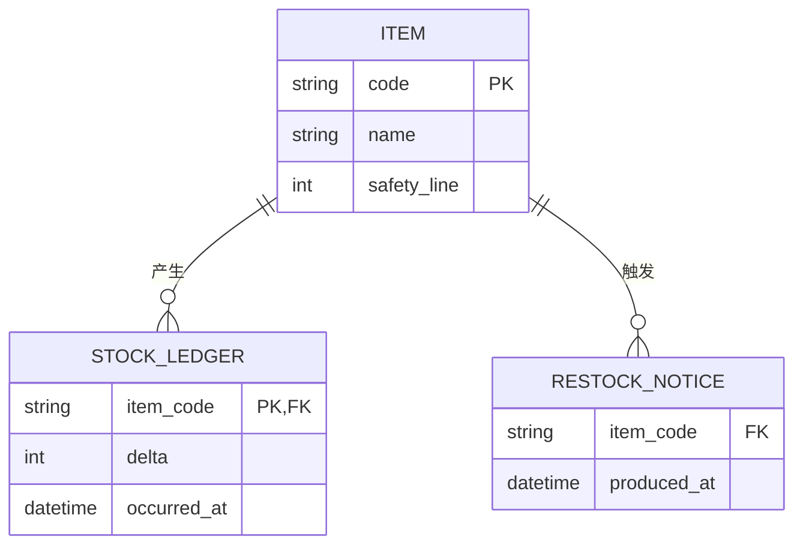

# data.md：数据模型（ER）细则

分析形态起草「数据模型」节时读本册。ER 方法一手出处是 Chen 1976（实体 =
"可明确识别的事物"，关系 = "实体间的关联"，属性 = "从实体集映射到值集的
函数"——关系本身也可带属性）。本技能的数据模型**停在概念 + 逻辑层**。

## 三层口径与停层线

概念 / 逻辑 / 物理三层划分在 IBM、AWS、微软、Oracle 四家口径一致：

| 层 | 装什么 | 本技能 |
|---|---|---|
| 概念层 | 业务实体与关系的高层视图（需求收集） | 画 |
| 逻辑层 | 实体 + 属性 + 关系，形式化记号、技术无关 | 画 |
| 物理层 | 具体 DBMS 实现：主外键落地、字段物理类型、索引、分区、调优 | **不画** |

物理层归实现（与"design 不含实现细节"同构）：图上不出现索引、视图、
触发器、分区、存储引擎等物理细节。属性类型用逻辑类型（string / int /
datetime），不写 DBMS 方言类型（varchar(255) 等）。

## 规范化：程度裁量，不是硬规

"逻辑层必须 3NF"无厂商一手硬性规定——Oracle 把 3NF 列为逻辑设计的
schema 选项之一（与 star/snowflake 并列）并讨论合理去规范化；IBM 口径是
"decide on a degree of normalization that balances the need to reduce
redundancy with performance requirements"。本技能的裁量基线：**逻辑层默认
3NF 起步**，冗余只有写出业务理由（读多写少的汇总投影、跨库可达性）才允许，
理由写图旁 note。

## mermaid erDiagram 保守子集

- 四基数（外侧字符 = 最大值，内侧字符 = 最小值）：

  | 记号 | 基数 |
  |---|---|
  | `\|o` | 零或一 |
  | `\|\|` | 恰一 |
  | `}o` | 零或多 |
  | `}\|` | 一或多 |

- 识别 / 非识别关系 = 实线（`--`）/ 虚线（`..`）：子实体主键含父键 →
  识别（实线）；子实体有独立主键、父键只作外键 → 非识别（虚线）。
- 键标：`PK` 主键、`FK` 外键、`UK` 唯一键，逗号并列（`string code PK,FK`）。
- 关系标签只支持单视角（"Some ER diagrams label relationships from both
  perspectives, but this is not supported here"）——挑读起来自然的一侧
  命名。
- 属性类型是自由字符串、无内置校验；不画的东西不依赖语法兜底，靠纪律。

## mermaid 例

注：STOCK_LEDGER 的 item_code 标 PK,FK——流水行由"物品 + 时间"识别是
领域事实；RESTOCK_NOTICE 独立编号（此处从略）则其 item_code 只标 FK。
PK/FK 是逻辑层记号（实体识别与引用约束），不是物理实现细节——画在
逻辑层属于本技能范围。

## 与三视图的分工

- 数据模型管"持久化什么"；流程模型的 datastore 是"流经哪里"；对象模型
  管"领域词汇"。三者同名实体必须指同一物（术语一致性走查由
  references/walkthrough.md 规程覆盖）。
- 数据模型只画"承载需求的实体"——代码库里已有的存储照实入图并标注
  「既有」，需求新增的标注「新增」。
