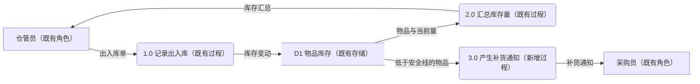

# flows.md：流程模型（DFD）细则

分析形态起草「流程模型」节时读本册。流程模型回答：数据怎么在系统与外部
之间流动、流经哪些加工与存储。方法出处：结构化分析（SA）的 DFD；本套件
采用 **Gane-Sarson 方言**——与 Yourdon/DeMarco 方言只差过程与数据存储两处
形状，其余相同（IBM 官方口径），且对 mermaid 最友好。DFD 四要素记法无现行
ISO/IEEE 规范性标准（ISO 5807 是文档符号约定、FIPS 183 已于 2008 撤回），
记号纪律以本册为准。

## 四要素

| 要素 | 语义 | mermaid 形状 |
|---|---|---|
| 外部实体 | 系统边界外的数据生产者 / 使用者（角色或外部系统） | 矩形 `id[text]` |
| 过程 | 把输入数据流变换成输出数据流的加工，**必须编号** | 圆角矩形 `id(text)` |
| 数据存储 | 系统与环境之间的数据缓冲 | `d1@{ shape: datastore, label: "D1 ..." }` |
| 数据流 | 具名数据的流动 | `A -->|数据名| B` |

- 过程编号：顶层用 `1.0 / 2.0 / 3.0`；细分子图用 `1.1 / 1.2`（子图编号 =
  所细化过程的编号）。
- 数据存储编号用 `D1 / D2` 前缀，数据流标签用名词（"出入库单"），不用动词。

## 无控制流

DFD 没有控制流（"A data-flow diagram has no control flow"）：判定、分支、
循环不属于流程模型——菱形与六边形不得入图。流程走到"判断"时，画的是
判断的**输入与输出数据流**（如"低于安全线的物品"是一条数据流），判断
本身归对象模型的状态或方案段的逻辑。

## 分层与 balancing

- context 图 = 单一过程代表整个系统 + 全部外部实体与边界数据流；Level 0
  把它分解为 3–7 个编号过程；再细才到 Level 1/2。Level 3 以上罕见
  （IBM 原文口径）——分析段多数需求画单层 Level 0 就够。
- **balancing（父子图数据流守恒）**：画了多层才适用——父图的边界数据流
  必须等于子图的外部数据流之和，组合流可拆包（"订单明细"拆成逐条），
  单子流须同名。没画多层就不触发此约束，不必为守恒强行分层。

## mermaid 例（Gane-Sarson 单层）

图中既有 / 新增的区分写在节点标签里（也可用 `%%` 注释行），起草前探索
代码库确认哪些是既有要素——既有要素入图作起点，需求新增的补在旁边。

## mermaid 版本注意

- `@{ shape: datastore }` 是 mermaid v11.3.0+ 语法（官方描述即 "Data flow
  diagram data store"）。宿主版本不可用 → 退经典圆柱 `id[(text)]`，
  图语义不变。
- 渲染兼容不设门禁：图文本可读性不依赖渲染——节点标签自含语义，
  渲染失败时读源码也能走查。
