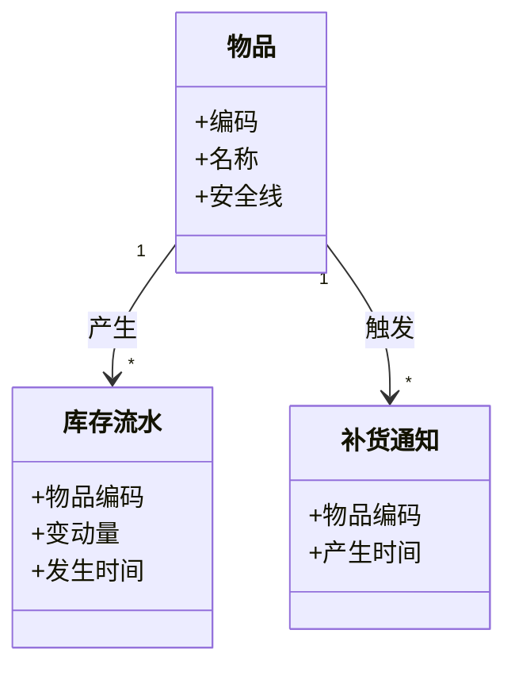

# objects.md：对象模型（概念层 UML 类图）细则

分析形态起草「对象模型」节时读本册。对象模型 = 概念类图，用途是建立
讨论领域的词汇表（"we aren't talking about software elements so much as
we are building a vocabulary to talk about a particular domain"，
Fowler；"A domain model does not show software artifacts or classes"，
Larman）。语义依据 OMG UML 2.5.1 规范。

## 必画四件

| 元素 | 说明 |
|---|---|
| 概念类 | 领域里的"东西"（物品、订单、通知），不是软件构件 |
| 命名关联 | 类之间的语义关系，给动词短语名（"产生""汇总自"） |
| 多重性 | 关联两端的合法基数（`1`、`0..1`、`1..*`、`*`） |
| 简单类型属性 | 只放简单数据类型（编码、数量、时间），不放对象引用 |

## 四个不该出现

1. **操作签名**——方法是纯软件概念，概念类无操作（Larman 原文
   "no operations are defined"）。
2. **导航箭头**——概念层不表达导航性，关联一律画普通实线。
3. **软件与 UI 类**——Repository、Service、Controller、页面组件不是
   领域词汇。
4. **外键式关联属性**——用属性表达关联是最常见违规（"Attributes should
   not be used to relate conceptual classes"）；A 引用 B 的关系画关联线，
  不在 A 里放 "B 编号" 属性。唯一例外：那个编号本身是领域事实（如
   流水单上记物品编码是业务内容）而非导航手段。

## 聚合与组合：慎用

OMG 规范明示聚合（shared，空心菱形）"Precise semantics … varies by
application area and modeler"——规范不给强语义，概念层**用普通关联
替代**；组合（composite，实心菱形）是强语义："部分同一时刻至多属于一个
整体；整体删除则部分随之删除"——只在"整体亡则部分亡"真的成立时用
（订单删则订单行亡）。拿不准 → 普通关联 + note 说明约束。

泛化（继承）用空心三角指向父类，只画真实的分类学关系（"企业客户 IS-A
客户"），不为复用属性凑继承。

## 克制清单

- 规范级省略口径：任何分栏可省且"no inference may be drawn"；多重性不画
  就是不表达推断——只画承载走查必需的元素。
- sketch 的本质是选择性："comprehensiveness is the enemy of
  comprehensibility"（Fowler）——图上每节点都要能指回 need 场景或需求
  术语；Exclude irrelevant features，"Do not add things that are not
  there"（Larman）。
- 按需建类：不为想象中的未来建类（CRC 原文 "creating objects not to meet
  mythical future needs, but only under the demands of the moment"）。
- 新术语当场对齐 GLOSSARY 项目术语章；歧义词在图上留 note 标注歧义，
  进「缺口与矛盾」节。

## mermaid classDiagram 保守子集

8 种关系记号可用；多重性写在关系两端引号内：

| 记号 | 关系 |
|---|---|
| `<|--` | 泛化（空心三角指向父） |
| `*--` | 组合（慎用） |
| `o--` | 聚合（概念层不用，见上） |
| `-->` | 关联 |
| `--` | 实线关联（无方向默认） |
| `..>` | 依赖（概念层不用） |
| `..|>` | 实现（概念层不用） |
| `..` | 虚线（概念层不用） |

降级策略：关联类、限定符、多元（三元以上）关联、导航性区分在 mermaid
无语法——一律降级为普通关联，语义差异写 `note`（`note for 类名 "说明"`）。

## mermaid 例

注：库存流水的"物品编码"是领域事实（流水单上必须记哪件物品），不是
导航手段，故放属性不违规；物品与流水的关系由关联线承载。
